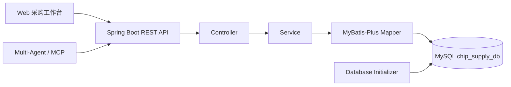

# ChipSupply Teaching Platform

> 一套可运行、可观测、可扩展的芯片供应链教学业务平台，为采购智能体提供真实的物料、供应商、库存与订单操作环境。


## 项目定位

本项目把芯片采购业务抽象为一套完整的教学型 ERP 后端，并配套原生 Web 工作台。它既可以独立演示采购流程，也可以作为 `ChipChain-Procurement-Agent` 的业务数据底座，通过稳定的 REST API 支撑多智能体查询、分析和订单执行。

所有供应商、制造商、EDU 料号、报价和订单均为虚构样本，仅用于技术演示与课堂实验。

## 核心能力

- **芯片物料中心**：覆盖 MCU、存储、电源管理、模拟、接口与传感器六类芯片，支持 MPN、封装、温度等级、MOQ 与交期管理。
- **供应网络管理**：维护供应商档案、信用等级和供货关系，支持多供应商比价场景。
- **库存与预警**：提供入库、出库、安全库存校验和库存预警接口。
- **采购订单闭环**：支持订单创建、明细查询、状态流转、金额重算和业务规则校验。
- **可复现教学数据**：首次启动自动建库建表，并写入一套版本化的芯片供应链样本。
- **可观测 API**：记录请求方法、路径、HTTP 状态和耗时；教学环境可输出 SQL 与绑定参数。

## 架构



## 技术栈

| 模块 | 技术 |
| --- | --- |
| 运行时 | Java 17 |
| Web 框架 | Spring Boot 3.1 |
| 数据访问 | MyBatis-Plus、Spring JDBC |
| 数据库 | MySQL 8 |
| API 文档 | SpringDoc OpenAPI / Swagger UI |
| 前端 | HTML、CSS、JavaScript |
| 测试 | Spring Boot Test |

## 快速开始

### 1. 环境要求

- Java 17+
- Maven 3.8+
- MySQL 8+

### 2. 配置

应用读取 `src/main/resources/application.yml`，推荐通过环境变量覆盖本地配置：

| 环境变量 | 默认值 | 说明 |
| --- | --- | --- |
| `SERVER_PORT` | `8082` | HTTP 服务端口 |
| `CHIP_DB_URL` | `jdbc:mysql://localhost:3306/chip_supply_db?...` | JDBC 连接地址 |
| `CHIP_DB_USER` | `root` | 数据库用户 |
| `CHIP_DB_PASSWORD` | `123456` | 仅用于本地教学的默认值，部署时必须覆盖 |
| `CHIP_DEMO_DATA` | `true` | 是否插入演示数据 |
| `CHIP_SQL_LOG_LEVEL` | `debug` | SQL 日志级别 |

### 3. 构建并运行

```bash
mvn clean test package
java -jar target/ChipSupplyTeachingSystem-1.0.0.jar
```

启动后访问：

- 采购工作台：`http://localhost:8082`
- Swagger UI：`http://localhost:8082/swagger-ui/index.html`
- REST API：`http://localhost:8082/api`

## API 概览

| 资源 | 基础路径 | 示例能力 |
| --- | --- | --- |
| 物料 | `/api/parts` | 分页、检索、供应商物料查询 |
| 供应商 | `/api/suppliers` | 分页、检索、维护 |
| 库存 | `/api/inventory` | 入库、出库、预警、可用量检查 |
| 采购订单 | `/api/orders` | 创建、修改、明细、统计、状态流转 |
| 物流 | `/api/logistics` | 物流记录查询与维护 |
| 统计 | `/api/statistics` | 采购与库存指标 |

## 教学数据集

| 内容 | 规模 / 规则 |
| --- | --- |
| 芯片分类 | 6 类 |
| 采购物料 | 24 条，12 个 MPN，每个 MPN 对应两家供应商 |
| 供应商 / 客户 / 员工 | 6 / 3 / 3 个虚构主体 |
| 库存 | 24 条，包含安全库存预警样本 |
| 采购订单 | 72 笔，覆盖近六个月 |
| 报价快照 | 24 页固定课堂报价 |

数据源位于 `docs/chip_catalog.json`，运行时建表和种子数据位于 `src/main/resources/db/`。如需完全重置演示数据，请创建一个空数据库后重新启动应用；初始化器通过数据集版本避免重复插入。

## 项目结构

```text
chip-portal/                       原生采购工作台
docs/                              数据字典与芯片目录
scripts/                           教学数据和界面校验脚本
src/main/java/com/chipsupply/
  controller/                      REST 接口
  service/                         业务规则
  mapper/                          数据访问
  entity/                          领域实体
  init/                            数据库初始化
src/main/resources/db/             Schema 与 Seed
src/test/                          自动化测试
```

## 与多智能体项目协作

`ChipChain-Procurement-Agent` 通过 MCP 将 Agent 工具映射到本项目的 REST API。两者采用独立数据库：本项目的 `chip_supply_db` 保存业务数据，Agent 项目的数据库保存账号、会话、检查点和沙箱绑定，避免业务状态与推理状态耦合。

## 验证

```bash
mvn test
```

> 安全提示：仓库内默认数据库密码只面向本地教学环境。任何共享或生产部署都应通过环境变量覆盖密码，并限制数据库与 Swagger 的网络访问范围。
